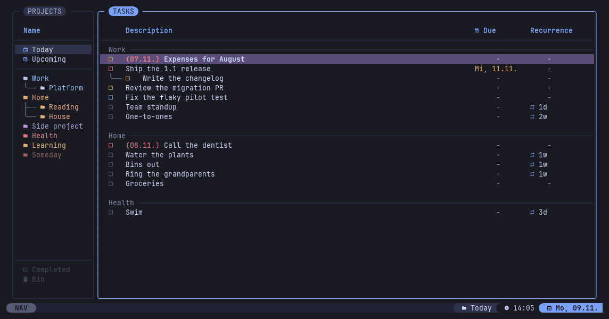

# todooit

[](https://gslama12.github.io/todooit/)
[](LICENSE)

A keyboard-driven todo app for the terminal: todos in a tree of projects, vim-like
keys, notes, dates and search. Started as a fork of
[dooit](https://github.com/dooit-org/dooit) and extended with the parts of Todoist
it was missing.

<p align="center">
  
</p>

📖 **[Documentation](https://gslama12.github.io/todooit/)**

## Features

- **Fixed views** — Today, Upcoming, Completed and a Bin, built from your real projects and jumped to with `gt` / `gu` / `gc` / `gb`.
- **Projects and steps** — projects nest as deep as you want, and so do tasks. `h` folds a task shut; planning a task plans every step under it.
- **Quick add** — `C` types a whole task in one line, with its project, priority and day.
- **Finder** — `/` searches every task in the database, not just the pane in front, and walks the cursor over to the one you pick.
- **Notes** — every task carries a markdown note (`space`), and `m` opens a pinned scratchpad for thoughts with no task yet.
- **Attachments** — copy a file anywhere on your machine and `ctrl+v` in a note pins it to the strip along the bottom of the note window. `f` picks the files up, `enter` opens one in whatever your desktop opens that file type with, `xx` detaches it. Nothing is written into the note and nothing is copied on disk — the task simply holds the way back to the file.
- **Dates** — due and scheduled dates typed as words (`next friday`) or picked off a calendar, and `r` makes a task recur.
- **Ordering** — `K` / `L` move a task, `I` / `U` nest it, `M` sends it to another project, and `SP` / `SD` / `SS` read a project by priority or date.
- **The small things** — `ctrl+c` / `ctrl+v` move tasks through the system clipboard, `o` opens the link under the cursor, `a` flags a task handed to an AI, `ctrl+z` takes back anything.

`?` shows the rest.

## Install

Needs Python 3.9+ on macOS, Linux or WSL, and a
[Nerd Font](https://www.nerdfonts.com/font-downloads) in your terminal — the
checkboxes, folders and calendars are all Nerd Font glyphs. Tested on
[WezTerm](https://wezterm.org/).

```bash
git clone https://github.com/gslama12/todooit
cd todooit
uv venv .venv && source .venv/bin/activate
uv pip install -e .
todooit
```

Other environment managers and the terminal setup are in the
[installation guide](https://gslama12.github.io/todooit/guide/installation).

## Configuration

Keybinds, colors, columns, the status bar and the dashboard are all set in Python
in `todooit/utils/default_config.py`, and your own file on top of it overrides any
of them — see [Configuration](https://gslama12.github.io/todooit/reference/configuration).

## Data

Todos live in `~/.local/share/todooit/todooit.db`, with generated CSS cached in
`~/.cache/todooit` and an optional config file in `~/.config/todooit`. Setting
`TODOOIT_HOME` moves all three into that one directory instead, giving a fully
isolated instance; `todooit --dev` is shorthand for one at
`~/.local/share/todooit-dev`, handy for trying changes out without touching your
real todos.

## Contributing

```bash
uv sync
uv run pytest -q              # -m smoke -n 4 for the quick check
uv run todooit --dev          # the app against a throwaway database
```

Branch off `dev`, never `main`. Appearance and behaviour changes belong in
`todooit/utils/default_config.py`; structural and rendering ones in `todooit/ui/`.
New features need tests — every test carries a marker for its feature, so
`uv run pytest -m notes` runs just that one. More in
[Development](https://gslama12.github.io/todooit/reference/development).

## Credits

MIT licensed. Based on [dooit](https://github.com/dooit-org/dooit) (upstream v3.3.4) and [dooit-extras](https://github.com/dooit-org/dooit-extras) by kraanzu and contributors; both source histories are preserved in this repo's git log.
