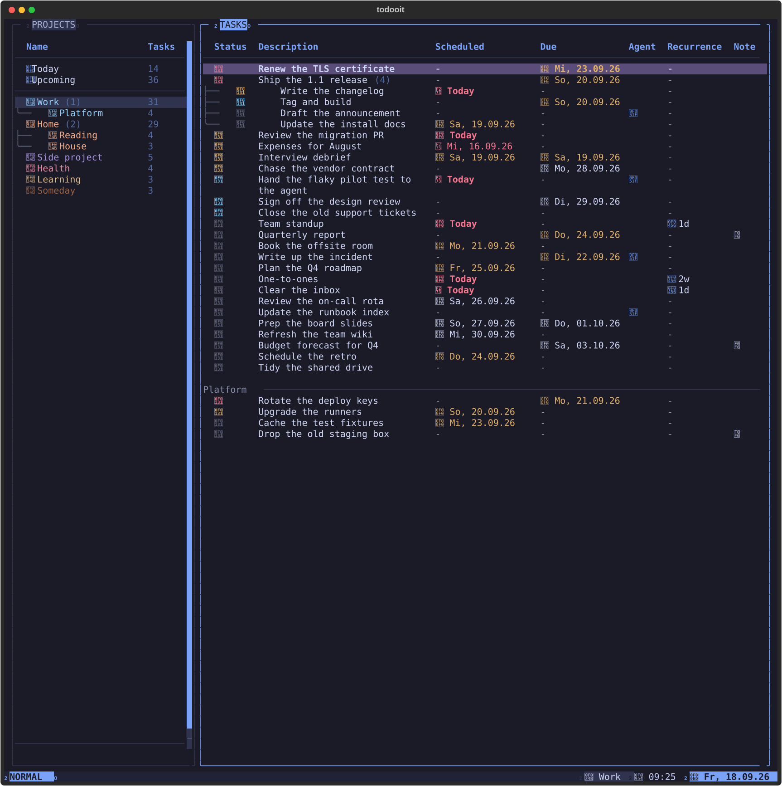

# todooit

[](https://gslama12.github.io/todooit/)
[](LICENSE)

A beautiful, versatile todo app in your terminal for a keyboard based workflow. For those wanting a fancy TUI todo list that can do more than just add/complete tasks. Started as a fork of "Dooit" extended with many features of "Todoist".

<p align="center">
  
</p>

📖 **[Documentation](https://gslama12.github.io/todooit/)**

## Added Features (inspired by Todoist)

- **Today / Upcoming / Completed / Bin** — fixed projects built from the real ones, jumped to with `gt`, `gu`, `gc`, `gb`, each with its own grouping.
- **Bin instead of deletion** — `xx` throws a task away, `u` fetches it back, `yy` deletes one for good and `YY` empties the whole Bin.
- **Quick add** — `C` types a whole task in one line, with its project, priority and day, from wherever the cursor happens to be.
- **Finder** — `/` searches every task in the database, not just the pane in front, and walks the cursor over to the one that is picked.
- **Notes** — every task carries a note (`space`) with an insert mode, selection, copy and paste; `m` opens a pinned scratchpad note for thoughts with no task yet.
- **Note markup** — markdown as you type it, with no formatting keys to learn: `- ` or `* ` opens a bullet and `tab` / `shift+tab` nest it, `1. ` numbers one, `> ` sets a line off as a green quote — lists inside one work, and go green with it — `# ` draws the rule a heading is titled over, `---` turns into a separator, and `*stars*` go orange, the stars themselves swapped for zero-width marks so emphasis opening a line costs no column.
- **Link opening** — `o` opens the link under the cursor, on a task row and inside a note alike.
- **Priority `p0`-`p3`** — Todoist's scale, typed as a chord and shown as a colored checkbox rather than a column of its own.
- **Agent flag `a`** — an hourglass in its own column on the tasks handed to an AI that is off working on them.
- **Natural language dates** — due and scheduled dates are typed as words, shown with their day name, and colored green through red as they come closer.
- **Calendar picker** — typing `cal` into a date field (`s` or `d`) opens an Austrian month over the app: Monday-first weeks, German names, public holidays in red, walked with `j`/`ö`/`k`/`l` and `J`/`Ö` for whole months, `t` back to today, and `enter` to pick. A time the task already carries is kept.
- **Recurrence on the scheduled date** — a recurring task moves its scheduled date on instead of carrying a due date.
- **Projects as folders** — projects nest and count their children, and a task is ticked off by hand rather than by its last step being done.
- **Moving tasks** — `I` / `U` file a task under the one above it or pull it back out, `ctrl+c` / `ctrl+v` copy and paste through the system clipboard, and `ctrl+n` takes a task's note without opening it.
- **Undo / redo `ctrl+z` / `ctrl+y`** — every edit either pane can make, walked back one key at a time and forward again: a rename, a priority, a task in the Bin, a task deleted for good, a whole project dropped with its work scattered into the Bin. The rows themselves are what is kept, so a key that moved half the tree comes back whole.
- **Sorting** — `SP`, `SD`, `SS` read a project by priority, due date or scheduled date.
- **Help screen** — `?` held down shows every keybind, grouped by what it is for.
- **Reworked look** — Tokyo Night colors, a status bar with the current mode, icons, headers, rounded lines, alternating row shading (`q`), and completed tasks struck through and grayed out.

## Install & run

> **Requires a [Nerd Font](https://www.nerdfonts.com/font-downloads).** Checkboxes, folders, calendars and the status bar are all Nerd Font glyphs, so without a patched font they come out as blank boxes. The screenshots here are JetBrainsMono Nerd Font.
>
> NOTE: Todooit was only tested on WezTerm. Other terminals may not show some of the icons correctly.

```lua
-- ~/.config/wezterm/wezterm.lua
config.font = wezterm.font('JetBrainsMono Nerd Font')
config.font_size = 10.5
config.color_scheme = 'Tokyo Night'
```

Pick whichever environment manager you already use; each installs the app editable, so editing the source is editing the running app.

With [uv](https://docs.astral.sh/uv/):

```bash
uv venv .venv && source .venv/bin/activate
uv pip install -e .
todooit
```

With the standard library's `venv`:

```bash
python3 -m venv .venv && source .venv/bin/activate
pip install -e .
todooit
```

With conda:

```bash
conda create -n todooit python=3.12 && conda activate todooit
pip install -e .
todooit
```

> Supported Operating Systems: MacOS, Linux, WSL.

## Layout

- `todooit/` — the app: a Textual TUI, todos in a tree of projects, SQLite via SQLAlchemy
- `todooit/extras/` — formatter / status-bar widget library (merged in from dooit-extras, trimmed to what the config uses)
- `todooit/utils/default_config.py` — the configuration: keybinds, formatters, bar, dashboard, colors
- `tests/` — the test suite (`python -m pytest tests`)

## Data

Todos live in `~/.local/share/todooit/todooit.db`, with generated CSS cached in `~/.cache/todooit`.

Setting `TODOOIT_HOME` moves the database, CSS cache and config into that one
directory instead, giving a fully isolated instance. `todooit --dev` is
shorthand for `TODOOIT_HOME=~/.local/share/todooit-dev` - handy for trying out config changes next to a running instance without touching your real todos.

## Credits

MIT licensed. Based on [dooit](https://github.com/dooit-org/dooit) (upstream v3.3.4) and [dooit-extras](https://github.com/dooit-org/dooit-extras) by kraanzu and contributors; both source histories are preserved in this repo's git log.
